### 1. Engineering Test Data Organizer
<table>
  <tr>
    <td><b>Student Inputs</b> 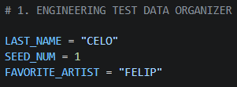</td>
    <td><b>Generated Data</b> 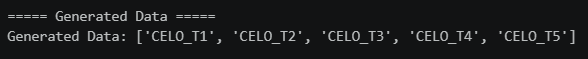</td>
    <td><b>Processing Results</b> 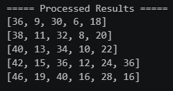</td>
    <td><b>Final Output</b> 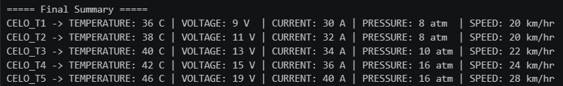</td>
  </tr>
<table>

### 2. Student Performance Data Analyzer
<table>
  <tr>
    <td><b>Student Inputs</b> 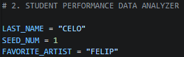</td>
    <td><b>Generated Data</b> 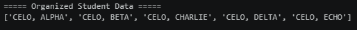</td>
    <td><b>Processing Results</b> 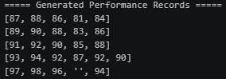</td>
    <td>
      <b>Final Output</b> 
      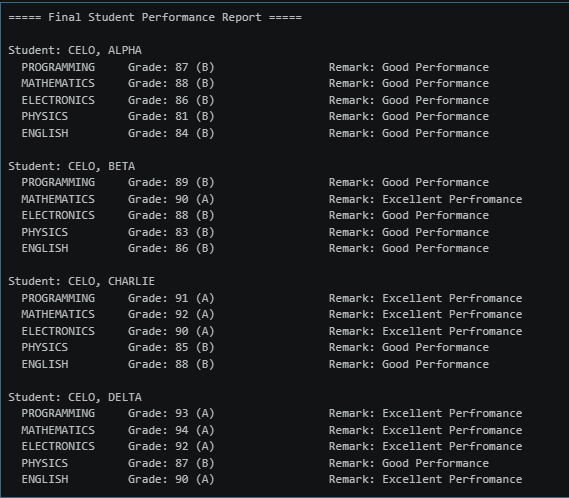  
      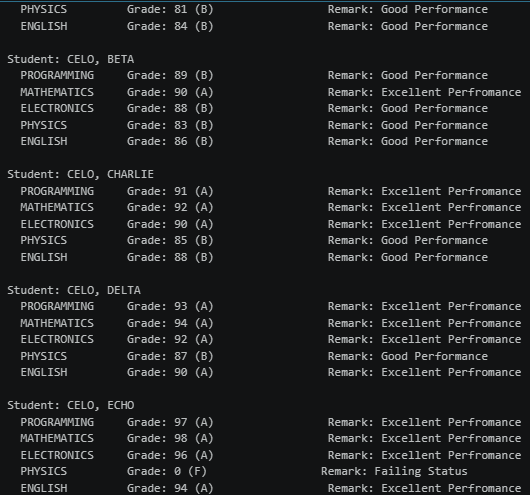
    </td>
  </tr>
</table>

### 3. transaction History Analyzer
<table>
  <tr>
    <td><b>Student Inputs</b> 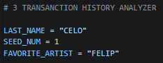</td>
    <td><b>Generated Data</b> 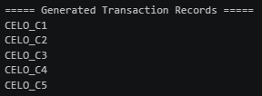</td>
    <td><b>Processing Results</b> 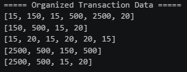</td>
    <td>
      <b>Final Output</b> 
      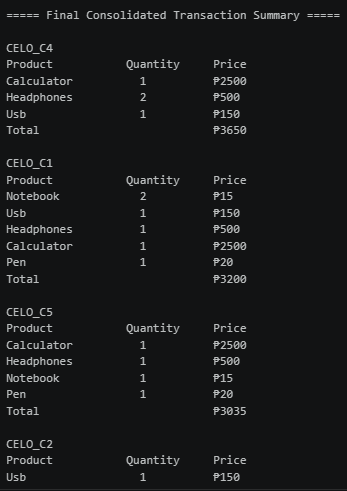  
      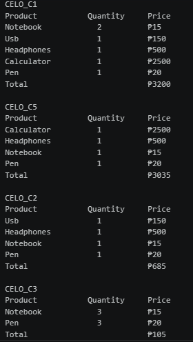
    </td> 
  </tr>
</table>
